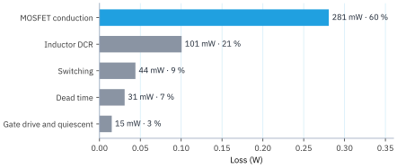
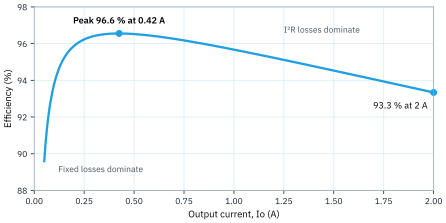

A synchronous buck at 2.2 MHz with L = 1.0 µH and 2 × 22 µF output capacitors meets the 5 V to 3.3 V, 2 A requirement with an estimated 93 % efficiency and about 3 mV output ripple. The controller is not chosen yet, so IC values in this draft are assumed.

## 1. Requirements

Values marked "assumed" are not given yet and need confirming.

Table: Requirements
| Parameter | Value |
| --- | --- |
| Input voltage, Vin | 5 V ± 5 % (4.75–5.25 V, assumed) |
| Output voltage, Vo | 3.3 V |
| Output current, Io | 2 A |
| Switching frequency, fsw | 2.2 MHz |
| Output ripple | ≤ 33 mV pp, 1 % of Vo (assumed) |
| Load step response | ≤ ±99 mV, 3 % of Vo, for a 1 A step (assumed) |
| Ambient temperature | ≤ 60 °C (assumed) |

## 2. Topology and controller

A synchronous buck IC with both MOSFETs integrated is the natural choice here:

- **Synchronous rectification.** At 3.3 V output, a 0.4 V diode would lose 0.4 × 2 × 0.34 = 0.27 W, about 4 % efficiency. A low-side MOSFET avoids most of it.
- **Integrated MOSFETs.** At 2 A and 2.2 MHz, short gate loops and small parasitics matter more than the last few mΩ of Rds(on).
- **2.2 MHz.** This keeps L and C small and places fsw above the AM radio band (0.53–1.7 MHz), which is common practice for automotive and audio designs.
- **Internal compensation.** Most ICs in this class have fixed internal compensation sized for a given L and Cout range; this draft assumes a crossover near fsw/10 = 220 kHz.

The IC values used later in this draft (Rds(on), switching times) are typical for this class and are marked as assumed.

## 3. Operating point

The ideal duty cycle is D = Vo/Vin. At 2.2 MHz the switching period is only 455 ns, so the IC's minimum on-time and off-time must be checked at the input limits:

Table: Duty cycle and switch timing
| Vin | D | On-time | Off-time |
| --- | --- | --- | --- |
| 4.75 V | 0.695 | 316 ns | 139 ns |
| 5.0 V | 0.660 | 300 ns | 155 ns |
| 5.25 V | 0.629 | 286 ns | 169 ns |

The tightest point is the 139 ns off-time at 4.75 V. Many 2 MHz-class ICs need 60–100 ns, so this is fine, but losses push D up by a few percent; confirm with the chosen IC. On-time is far from any typical limit.

## 4. Inductor

The inductor is sized for a ripple current of about 30 % of Io at the highest input voltage, where ripple is largest:

```latex
L = \frac{V_o\,(1 - D)}{\Delta I_L\, f_{sw}} = \frac{3.3 \times (1 - 0.629)}{0.6 \times 2.2\ \mathrm{MHz}} = 0.93\ \mathrm{\mu H}
```

Choose the standard value L = 1.0 µH. The resulting currents are:

Table: Inductor currents with L = 1.0 µH
| Vin | Ripple ΔI_{L} (pp) | Ripple / Io | Peak current | RMS current |
| --- | --- | --- | --- | --- |
| 4.75 V | 0.46 A | 23 % | 2.23 A | 2.00 A |
| 5.0 V | 0.51 A | 26 % | 2.26 A | 2.01 A |
| 5.25 V | 0.56 A | 28 % | 2.28 A | 2.01 A |

**Inductor requirements.**

- Saturation current ≥ the IC's current limit (typically 3–4 A for a 2 A part), not just the 2.28 A peak, so a short circuit does not saturate the core.
- RMS current rating ≥ 2.1 A.
- DCR ≤ 25 mΩ (0.10 W at 2 A).
- Core material rated for 2.2 MHz; check core loss at 0.56 A pp ripple, which can be larger than the DCR loss at this frequency.

## 5. Output capacitor

Use 2 × 22 µF ceramic (X5R or X7R, 0805, ≥ 6.3 V). At 3.3 V DC bias the effective value is lower; this draft assumes 30 µF total and 3 mΩ ESR.

**Ripple.** At 5.25 V, where ΔI_{L} = 0.56 A:

```latex
\Delta V_o \approx \frac{\Delta I_L}{8\, f_{sw}\, C_o} + \Delta I_L \cdot ESR = \frac{0.56}{8 \times 2.2\ \mathrm{MHz} \times 30\ \mathrm{\mu F}} + 0.56 \times 3\ \mathrm{m\Omega} = 1.1 + 1.7 = 2.8\ \mathrm{mV}
```

This is well inside the 33 mV target.

**Load step.** With a loop crossover fc near 220 kHz, a 1 A step gives roughly:

```latex
\Delta V_o \approx \frac{\Delta I_{step}}{2\pi f_c C_o} = \frac{1}{2\pi \times 220\ \mathrm{kHz} \times 30\ \mathrm{\mu F}} = 24\ \mathrm{mV}
```

This is inside the ±99 mV target. The real value depends on the IC's compensation; the IC datasheet usually gives a recommended Cout range, and Cout must stay within it for the loop to be stable.

## 6. Input capacitor

The input capacitor carries the pulsed part of the input current. At Vin = 5 V (D = 0.66):

```latex
I_{Cin,rms} = I_o\sqrt{D\,(1-D)} = 2 \times \sqrt{0.66 \times 0.34} = 0.95\ \mathrm{A_{rms}}
```

Use 10 µF ceramic (X7R, 0805, ≥ 10 V) plus 0.1 µF (0402) placed right at the IC's VIN and GND pins. Assuming 7 µF effective at 5 V bias, the input ripple is:

```latex
\Delta V_{in} = \frac{I_o\, D\,(1-D)}{f_{sw}\, C_{in}} = \frac{2 \times 0.66 \times 0.34}{2.2\ \mathrm{MHz} \times 7\ \mathrm{\mu F}} = 29\ \mathrm{mV}
```

The 0.1 µF part handles the fast edges; its loop from VIN to GND through the IC is the hot loop and must be as small as possible.

## 7. Loss, efficiency and thermal estimate

With assumed IC values and an inductor DCR of 25 mΩ, the total loss at 5 V and 2 A is about 0.47 W. With Po = 6.6 W, the estimated efficiency is 93.3 %.

{width=88%}

The main loss terms are:

```latex
P_{cond} = I_{rms}^2 \left[D\,R_{ds,H} + (1-D)\,R_{ds,L}\right] = 2.01^2 \times (0.66 \times 0.08 + 0.34 \times 0.05) = 0.28\ \mathrm{W}
```

```latex
P_{sw} \approx \tfrac{1}{2} V_{in} I_o (t_r + t_f) f_{sw} = 0.5 \times 5 \times 2 \times 4\ \mathrm{ns} \times 2.2\ \mathrm{MHz} = 0.044\ \mathrm{W}
```

**Efficiency against load.** Conduction and DCR losses grow with the square of current, while gate drive and quiescent losses stay fixed. So efficiency peaks at mid load and falls at both ends:

{width=88%}

The curve assumes forced PWM. If the chosen IC uses a light-load mode (PFM or pulse skipping), efficiency below about 0.3 A will be higher than shown.

**Thermal.** About 0.37 W of the loss is inside the IC. With an assumed θ_{JA} of 40 °C/W on a 4-layer board, the junction runs about 15 °C above ambient, so about 75 °C at 60 °C ambient. The inductor's 0.10 W DCR loss plus core loss should be checked against its temperature-rise rating.

## 8. Open items and next steps

### 8.1 Choose the IC

Confirm Rds(on), current limit, minimum off-time (≤ 100 ns), fsw setting, and the recommended L and Cout range. Then replace the assumed values in Sections 2, 3 and 7.

### 8.2 Confirm requirements

Confirm the values marked as assumed in Section 1: input tolerance, ripple and load-step limits, and ambient temperature.

### 8.3 Capacitor DC bias

Check the effective capacitance of the 22 µF and 10 µF parts at 3.3 V and 5 V bias, then update Sections 5 and 6.

### 8.4 Inductor

Pick a part against Section 4 and check core loss at 2.2 MHz.

### 8.5 Input filter

If an input filter is needed, note that the converter's input resistance is low: |Rn| = Vin²/Pin = 5²/7.1 = 3.5 Ω. The filter's peak output impedance must stay well below this (Middlebrook's criterion). Damping by series resistance in the filter inductor costs P·R/Vin² of the power, which is 2.8 % for every 0.1 Ω at 5 V and 7.1 W. An Rd–Cd damping branch, or a filter with a lower Z0, is the better choice here.

As an example, an undamped filter of L = 1 µH (DCR 15 mΩ) feeding the converter's own 10 µF Cin has Z0 = 0.32 Ω and f0 = 50.3 kHz. Its only damping is the DCR, so Q = 21 and the |Zo| peak is 6.7 Ω, above |Rn|:

{width=92%}

This filter would make the converter unstable near 50 kHz. It needs damping that brings the peak at least 6 dB below 3.5 Ω, that is below about 1.8 Ω.

### 8.6 Layout

Keep the input hot loop (Cin, VIN, GND) as small as possible, keep the switch node small, and use a solid ground plane under the IC.

### 8.7 Bench verification

Measure the efficiency curve, output ripple, load step, loop response, and a thermal image at 2 A.
