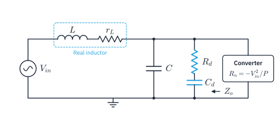

A 1.06 Ω damping resistor in series with 150 µF gives the 48 V, 100 W converter's input filter a peak output impedance of 1.06 Ω, 26.8 dB below the converter's 23.0 Ω input impedance.

## 1. Circuit

{width=86%}

Zo is the filter's output impedance seen by the converter, with the source Vin shorted. Cd blocks DC so that Rd dissipates only ripple power.

## 2. Design equation

The damping resistor that sets the filter's Q at a target value is:

```latex
R_d = \frac{Z_0^2}{\dfrac{Z_0}{Q} - r_L}, \qquad Z_0 = \sqrt{\frac{L}{C}}
```

**Why it holds.** A tightly regulated converter draws constant power, so its small-signal input impedance is a negative resistance Rn = −Vin²/P. For a buck converter with load resistance R and duty cycle D, Vo = D·Vin and P = Vo²/R, so equivalently Rn = −R/D². For stability, the filter's output impedance Zo must stay well below |Rn| at all frequencies (Middlebrook's criterion). With Cd acting as a short at f0, the derivation takes three steps:

1. Transform the lossy inductor from series to parallel form. With Qu = Z0/rL ≫ 1, the loss becomes Rp ≈ Z0²/rL across the output node, and Lp ≈ L.
2. At f0, Lp and C cancel. The node is left with Rd in parallel with Rp.
3. The node's parallel Q is Rtot/Z0, so the conductances add:

```latex
Z_o(\omega_0) = Q\,Z_0 = \left(\frac{1}{R_d} + \frac{r_L}{Z_0^2}\right)^{-1}
```

Solving Eq. (2) for Rd gives Eq. (1). The only approximation is Qu ≫ 1, so the equation stays accurate at a low target Q. The full derivation, including the input-side route, is in Calculation Report: L-Match Network with Lossy Inductor.

## 3. Design inputs

> The input values are illustrative. Use rL at f0, not the DC resistance.

Table: Design inputs
| Input | Value |
| --- | --- |
| Vin | 48 V |
| P | 100 W |
| L | 22 µH |
| rL (ESR at f0) | 20 mΩ |
| C | 10 µF |
| Target Q | 0.707 |

## 4. Design steps

Six steps take the inputs to Rd = 1.06 Ω and Cd = 150 µF. The filter resonates at:

$$ f_0 = \frac{1}{2\pi\sqrt{LC}} \nonumber $$

1. Converter input resistance: Rn = −48² / 100 = −23.0 Ω. For a buck output of Vo = 12 V, D = 12/48 = 0.25 and R = 12²/100 = 1.44 Ω, so −R/D² = −1.44/0.25² = −23.0 Ω as well.
2. Filter: Z0 = √(22 µH / 10 µF) = 1.483 Ω, f0 = 10.73 kHz, Qu = 1.483 / 0.020 = 74.2.
3. Undamped peak: Qu·Z0 = 110 Ω. This exceeds |Rn| = 23.0 Ω, so the system can oscillate.
4. Target Q = 0.707 sets the peak to Q·Z0 = 1.05 Ω, a factor of 22 (26.8 dB) below |Rn|. With Rd as the filter's load, Q = 0.707 also gives a maximally flat (Butterworth) transfer function with no peaking.
5. Damping resistor: Rd = 1.483² / (1.483/0.707 − 0.020) = 2.200 / 2.078 = 1.06 Ω. A lossless inductor would need 1.05 Ω; the inductor loss lets Rd be 1% larger.
6. Blocking capacitor: Cd in series with Rd keeps DC current out of the resistor. Cd = 150 µF gives a reactance of 0.099 Ω at f0, about Rd/10. The low target Q needs a small Rd, so Cd must be 15 times C.

Size Rd's power rating from the ripple current at f0.

## 5. Verification

An exact AC sweep of Zo from 1 kHz to 1 MHz, with the source shorted, confirms the design:

| Case | Peak \|Zo\| | Peak frequency | Margin below \|Rn\| |
| --- | --- | --- | --- |
| Undamped | 110 Ω | 10.73 kHz | −13.6 dB (violated) |
| Rd only, ideal | 1.05 Ω | 10.83 kHz | 26.8 dB |
| Rd + Cd = 150 µF | 1.06 Ω | 10.03 kHz | 26.8 dB |

{width=92%}

Only the damped curve stays below the converter’s |Zin| line at every frequency. Phase is omitted because Middlebrook’s criterion is checked on magnitude.

## 6. Conclusion

Rd = 1.06 Ω in series with Cd = 150 µF damps the filter to Q = 0.707, with a peak |Zo| of 1.06 Ω, 26.8 dB below the converter's 23.0 Ω. The cost of the low Q is a blocking capacitor 15 times the filter capacitor. A higher target Q, such as 2, would allow Rd = 3.05 Ω and Cd = 47 µF at a 17.7 dB margin.
